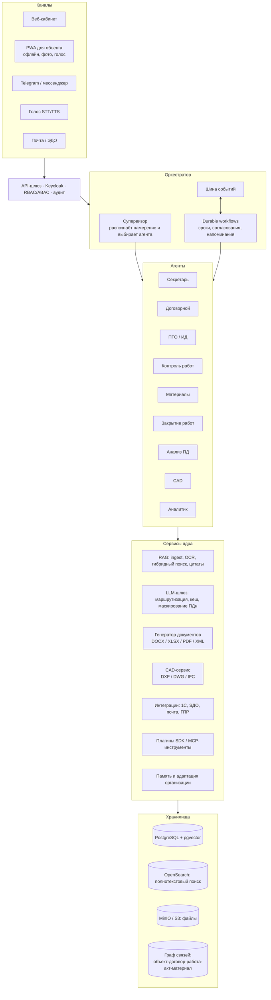

# BIS — план создания ИИ-платформы для строительных компаний

> Версия 0.4 · 07.11.2026 · концепция: ИИ, встроенный в производство (ИИ-конвейер, несколько специалистов);
> фаза 1 выполнена, ключевые функции фаз 2–5 реализованы, ждут данных пилота и моделей

## 0. Концепция: ИИ в производстве, а не оболочка

Компании не нужна ещё одна система, куда люди вносят данные. Данные уже возникают на производстве: прораб
фотографирует армирование и пишет в мессенджер «залили 290 кубов», поставщик присылает УПД, лаборатория —
протокол, геодезист — съёмку, заказчик — письмо. BIS встраивается в этот поток:

1. **Приём там, где люди уже работают.** Telegram-бот, почта, загрузка, API. Без форм и обязательных полей.
2. **Несколько ИИ, каждый силён в своём.** Зрение (фото), слух (голос), чтец документов (УПД, сертификаты,
   протоколы), диспетчер, инженер ПТО, юрист, экономист, геодезист, секретарь, контролёр, аналитик. У каждого
   свой маршрут в LLM-шлюзе — своя модель или правила.
3. **ИИ делает работу, человек решает.** Действия ИИ (объём, расход, приход, привязка сертификата, поручение,
   АОСР, схема, договор на контроль) выполняются сразу или ждут решения — по политике самостоятельности
   организации и уверенности модели. Всё видно в «Ленте ИИ», всё можно откатить.
4. **Контролёр сверяет источники.** Факт с площадки сверяется с накладными, нормами, сметой, сертификатами
   и протоколами — противоречия становятся замечаниями и поручениями сами.
5. **Документы собираются из фактов.** Сообщение «закончили армирование захватки 3» → объём → АОСР на эту
   захватку с материалами и их сертификатами, исполнительной схемой, шифром РД и пунктами норм.
6. **Обучение на решениях.** Исправление (другой материал, другая позиция сметы) становится примером
   сопоставления; причина отклонения — правилом специалисту; статистика решений подсказывает, где ИИ
   заслужил самостоятельность, а где должен спрашивать.

Реестры, формы и чат остаются — как данные и инструменты, а не как основной интерфейс.

## 1. Цель и принципы

**Цель:** автоматизировать большую часть документооборота и контроля на стройке: нормативную базу,
договоры, письма, исполнительную документацию (ИД), закрытие работ, списание материалов.
Платформа должна разворачиваться в любой строительной компании и подстраиваться под неё.

**Принципы:**

1. **ИИ делает, человек решает.** Рутинные действия ИИ выполняет сам (по политике организации и с откатом),
   значимые — предлагает. Юридически значимые документы (акты, договоры, письма) — черновики; подписывает человек.
2. **Каждый ответ со ссылкой на источник:** пункт СП или ГОСТ, договор, письмо.
3. **Числа считает код, а не LLM.** Объёмы, суммы, нормы расхода, сроки вычисляются детерминированно.
   LLM только извлекает данные и формулирует текст.
4. **Модель ИИ можно заменить.** Платформа работает с облачными API, российскими моделями
   и локальными open-weight моделями в закрытом контуре.
5. **Шаблоны и правила хранятся как данные.** Изменения форм ИД или законодательства вносятся
   без переписывания кода.
6. **Мультиарендность и изоляция.** Данные каждой организации (тенанта) хранятся отдельно.
   Можно поставить «коробку» on-prem или работать по SaaS.
7. **Расширяемость через плагины:** коннекторы, агенты и инструменты по единому SDK.

## 2. Архитектура

### 2.1. Модули

| # | Модуль | Назначение | Технологии |
|---|--------|------------|------------|
| 1 | **Ядро** | Организации, пользователи, роли, объекты, договоры, контрагенты, ответственные (приказы о назначении), реестр документов, аудит | Python, FastAPI, PostgreSQL, Keycloak |
| 2 | **База знаний / RAG** | Загрузка PDF, DOCX, XLSX, сканов (OCR), писем, DWG и IFC. Нормативы режутся на чанки по структуре документа (раздел → пункт). Метаданные: редакция, статус «действует/отменён», дата введения. Поиск гибридный (BM25 + векторы) с реранкером. Ответы содержат цитаты | pgvector / Qdrant, OpenSearch, bge-m3, bge-reranker, Docling, PaddleOCR |
| 3 | **LLM-шлюз** | Единый API к моделям, маршрутизация по задачам (дешёвая или мощная модель), лимиты, кеш, маскирование ПДн, трассировка | OpenAI-совместимый API, vLLM для локальных моделей, Langfuse |
| 4 | **Оркестратор** | Супервизор-агент, граф агентов, долгие процессы (контроль сроков по договору длится месяцами), событийная модель | Собственный граф агентов, Temporal, NATS |
| 5 | **Агенты** | См. раздел 3 | — |
| 6 | **Плагины** | SDK: манифест, права, инструменты в формате MCP, песочница. Внутренний каталог плагинов организации | Python SDK, MCP |
| 7 | **Генератор документов** | Шаблоны организации и типовые формы: АОСР, АООК, акты испытаний, реестры ИД (Приказ Минстроя № 344/пр), КС-2, КС-3, М-29, акты списания, письма, приказы, договоры (библиотека пунктов). Выгрузка в PDF/A, XML-схемы электронной ИД, электронная подпись | docxtpl, openpyxl, LibreOffice headless, КриптоПро |
| 8 | **CAD** | Исполнительные схемы: проектный DXF/DWG + геодезическая съёмка (координаты, отметки) → схема с фактическими отклонениями и штампом по ГОСТ Р 21.101. Позже плагины для nanoCAD, AutoCAD и Renga | ezdxf, ODA File Converter, IfcOpenShell, shapely |
| 9 | **Анализ ПД** | Проверка комплектности (ПП РФ № 87), извлечение ведомостей объёмов и спецификаций, поиск противоречий между разделами, проверка требований с цитатой нормы, ведомость замечаний | RAG + LLM + парсинг таблиц |
| 10 | **Голос** | Команды («сделай АОСР на армирование плиты, захватка 3»), диктовка в журнал работ, протокол совещания из аудиозаписи | faster-whisper, Silero / Piper, VAD; опционально SpeechKit |
| 11 | **Оболочка** | Единый чат-ассистент. Рабочие столы по ролям: ПТО, прораб, снабжение, юрист, руководитель. Очередь на утверждение, канбан задач агентов, реестры, дашборды | React, TypeScript, Next.js, PWA |
| 12 | **Адаптация** | Мастер онбординга. Память организации: реквизиты, формулировки, предпочтения. Обучение на правках пользователей. Наборы тестов (eval) на организацию | См. раздел 5 |
| 13 | **Безопасность** | RBAC + ABAC (доступ по объектам), изоляция тенантов, журнал всех действий агентов, режим «только черновик», шифрование, on-prem, требования 152-ФЗ | Keycloak, OPA, Vault |

## 3. Агенты

| Агент | Что делает | Триггеры | Результат |
|-------|-----------|----------|-----------|
| **Секретарь** | Регистрирует входящие (почта, сканы), классифицирует их, извлекает поручения и сроки, назначает исполнителей, готовит черновики ответов и приказов, напоминает о сроках, составляет протоколы совещаний | Новое письмо, голос, расписание | Карточка документа, поручения, черновики |
| **Договорной** | Разбирает договоры подряда, субподряда и поставки. Ведёт реестр обязательств: сроки, авансы, гарантии, штрафы, условия приёмки. Проверяет проект договора по чек-листу компании, готовит претензии | Новый договор, наступление срока | Реестр обязательств, риски, претензии |
| **Контроль ответственности** | Ведёт матрицу «обязательство → ответственный → срок → статус» и эскалирует просрочки | Workflow-таймеры | Уведомления, эскалации |
| **ПТО / ИД** | Готовит АОСР, АООК, акты испытаний, реестры ИД. Проверяет комплектность ИД по видам работ и связь с журналами и сертификатами на материалы | Запись в журнале работ, команда | Комплект ИД (черновики) |
| **Контроль выполнения работ** | Сравнивает план и факт по ГПР на основе журналов, отчётов прорабов и фото. Выявляет отклонения и прогнозирует сроки | Ежедневно, новый отчёт | Сводка, предупреждения |
| **Материалы** | Учитывает приход (УПД, накладные), считает расход по нормам (ГЭСН и нормы компании), формирует М-29 и акты списания, выявляет перерасход, сверяет давальческие материалы | Закрытие периода, приход | М-29, акты списания, отчёт по отклонениям |
| **Закрытие работ** | Формирует КС-2 и КС-3 из объёмов, подтверждённых ИД. Сверяет их со сметой и договором и собирает пакет на закрытие | Конец периода | КС-2, КС-3, пакет документов |
| **Нормоконтроль / анализ ПД** | Проверяет проектную документацию и отвечает на вопросы по нормам с цитатами | Загрузка ПД, вопрос | Замечания, ответы |
| **CAD** | Строит исполнительные схемы и выгружает их в DXF, DWG и PDF | Съёмка геодезиста, команда | Чертёж |
| **Аналитик** | Отвечает на вопросы по всем данным компании, готовит сводки и дашборды для руководства | Запрос, расписание | Отчёты |

Работа агентов строится по одной схеме: **триггер → сбор данных (RAG и БД) → расчёт кодом →
генерация → проверка (валидация по схеме и правилам) → утверждение человеком → публикация и событие**.

## 4. Этапы

| Фаза | Срок | Результат |
|------|------|-----------|
| **Ф0. Обследование и архитектура** | мес. 1 | Обследование пилотной компании, сбор образцов документов, ТЗ, финальная архитектура, прототип RAG по нормативам |
| **Ф1. MVP ядра** | мес. 2–4 | Ядро, авторизация, LLM-шлюз, RAG по нормативам и документам организации, чат с цитатами, загрузка писем и договоров, генерация писем, веб-оболочка v1 |
| **Ф2. Документы ИД и закрытия** | мес. 4–7 | АОСР, АООК, реестры ИД, КС-2, КС-3, М-29, акты списания, конструктор шаблонов, агенты «Секретарь» и «ПТО» |
| **Ф3. Агенты контроля и интеграции** | мес. 6–10 | Агенты «Договорной», «Контроль работ», «Материалы», «Закрытие», durable workflows, интеграции с 1С, почтой, ЭДО и мессенджером |
| **Ф4. CAD и анализ ПД** | мес. 8–12 | Исполнительные схемы, DWG, анализ ПД, нормоконтроль |
| **Ф5. Голос, мобильная версия, адаптация, тиражирование** | мес. 10–14 | Голос, PWA, дообучение, установщик, мультиарендность, переход от пилота к промышленной эксплуатации |

**Итого:** MVP через **~4 месяца**, промышленная версия 1.0 через **12–14 месяцев**. Фазы частично
идут параллельно.

## 5. Как система подстраивается под организацию

1. **Онбординг-мастер.** Загружаются реквизиты, оргструктура, приказы о назначении ответственных,
   шаблоны, договоры и архив документов. Из них автоматически собираются справочники: объекты,
   контрагенты, ответственные, виды работ.
2. **Корпоративный RAG.** Все документы организации индексируются, поиск и генерация опираются на них.
3. **Память организации:** формулировки, реквизиты, стиль писем, принятые решения.
4. **Обучение на правках.** Система сравнивает черновик агента с финальной версией. Из разницы
   получаются правила и примеры (few-shot) для этой организации.
5. **Дообучение (опционально).** Для локальных моделей раз в квартал проводится LoRA fine-tune
   на накопленных одобренных документах.
6. **Контроль качества.** У каждой организации есть свой набор тестов. Обновления проверяются на нём
   до выкладки.

## 6. Трудозатраты

| Блок | Человеко-месяцы |
|------|----:|
| Обследование, аналитика, ТЗ, методология ПТО | 10 |
| Архитектура, DevOps, ИБ | 10 |
| Ядро платформы, мультиарендность, справочники | 10 |
| RAG, загрузка, OCR, нормативная база | 12 |
| LLM-шлюз, оркестратор, агентный фреймворк, SDK плагинов | 12 |
| Генерация документов (ИД, КС, М-29, письма, договоры) | 12 |
| Агенты (10 шт.): логика, промпты, тесты | 14 |
| Интеграции (1С, почта, ЭДО, мессенджеры) | 8 |
| CAD-модуль (схемы, DXF/DWG, BIM) | 12 |
| Анализ проектной документации | 7 |
| Голос | 4 |
| Фронтенд (веб + PWA) | 14 |
| Адаптация, дообучение, оценка качества | 6 |
| Тестирование | 9 |
| Управление проектом | 10 |
| **Итого** | **~150** |

**Два варианта исполнения:**

- **Классическая команда:** 10–12 человек, 12–14 месяцев, около 150 чел.-мес.
- **ИИ-разработка (основной код пишет Claude, команда ревьюит и внедряет):** 4–6 человек,
  10–12 месяцев, ориентировочно 60–70 чел.-мес. Обследование, экспертиза ПТО, тесты на реальных
  данных и внедрение по-прежнему делают люди.

## 7. Необходимые ресурсы

### 7.1. Команда (вариант с ИИ-разработкой)

| Роль | Загрузка | Зачем |
|------|---------|-------|
| Руководитель проекта / владелец продукта | 1.0 | Приоритеты, приёмка, связь с заказчиками |
| **Эксперт ПТО / инженер-сметчик** | 1.0 | Ключевая роль: формы ИД, логика закрытия работ, проверка результатов |
| Юрист по строительным договорам | 0.25–0.5 | Чек-листы договоров, претензии |
| Backend / ML-инженер | 1–2 | Ревью кода, инфраструктура, интеграции, модели |
| Фронтенд-разработчик | 1.0 | Интерфейс, PWA |
| DevOps / ИБ | 0.5 | Развёртывание, безопасность |
| Тестировщик (лучше бывший сотрудник ПТО) | 1.0 | Проверка на реальных документах |
| Программист 1С | 0.5 (Ф3) | Интеграция с 1С |
| CAD-инженер | 0.5 (Ф4) | Требования к схемам, проверка чертежей |

### 7.2. Инфраструктура

- **Dev/stage:** сервер 16 vCPU, 64 ГБ RAM, 1 ТБ SSD. GPU желателен для эмбеддингов и тестов
  локальных моделей.
- **Prod на компанию до ~200 пользователей:**
  - сервер приложений: 32 vCPU, 128 ГБ RAM, 2–4 ТБ SSD;
  - ИИ: либо облачный API (оплата за токены), либо GPU-сервер для закрытого контура:
    2–4 GPU по 48–80 ГБ (L40S, A100, H100) под open-weight модель класса 30–70B.
- Резервное копирование, мониторинг (Prometheus, Grafana), трассировка LLM (Langfuse).

### 7.3. Данные и лицензии

- **Нормативная база:** легальный источник (Кодекс / Техэксперт или официальные публикации).
  На тексты ГОСТов распространяются права правообладателя.
- **От пилотной компании:** 50–200 образцов каждого типа документов (АОСР, КС-2, М-29, письма,
  договоры, ППР, сметы, ГПР), шаблоны, оргструктура, приказы, доступ к тестовой базе 1С.
- **Пилотный объект** с действующей стройкой.
- **Лицензии:** ODA (DWG), КриптоПро (ЭП), API ЭДО (Диадок / СБИС), LLM API или GPU.

## 8. Технологический стек

- **Backend:** Python 3.12, FastAPI, SQLAlchemy, Pydantic, Temporal, NATS, Redis.
- **Данные:** PostgreSQL 16 + pgvector, OpenSearch, MinIO.
- **ИИ:** LLM-шлюз → Claude, GigaChat, YandexGPT или локальные модели через vLLM;
  bge-m3 и bge-reranker; Docling и PaddleOCR.
- **CAD:** ezdxf, ODA File Converter, IfcOpenShell, shapely.
- **Документы:** docxtpl, openpyxl, LibreOffice headless.
- **Голос:** faster-whisper, Silero / Piper.
- **Фронтенд:** React, TypeScript, Next.js, Tailwind, PWA.
- **Инфраструктура:** Docker, docker compose (малые установки), Kubernetes и Helm, Keycloak,
  OpenTelemetry.

## 9. Риски

| Риск | Мера |
|------|------|
| Галлюцинации в значимых документах | Только черновики, обязательное утверждение, цитаты, валидация по схемам, расчёты кодом |
| Плохие исходные данные (сканы, разнородные шаблоны) | OCR, ручная верификация на онбординге, обучение на правках |
| Устаревание нормативов | Регулярное обновление, статусы редакций, предупреждение при ссылке на отменённую норму |
| У каждой компании своя конфигурация 1С | Слой адаптеров, типовые коннекторы к популярным конфигурациям |
| Конфиденциальность | On-prem и закрытый контур, маскирование ПДн, локальные модели |
| Изменение форм ИД и законодательства | Шаблоны хранятся как данные с версиями |
| Сопротивление пользователей | Простая оболочка, голос, мессенджер, постепенное внедрение |

## 10. Принятые решения (06.11.2026)

| Вопрос | Решение | Что это значит для архитектуры |
|--------|---------|--------------------------------|
| Юрисдикция | **РФ** | СП, ГОСТ, СНиП; формы ИД по Приказу Минстроя № 344/пр; 152-ФЗ |
| Размещение ИИ | **Гибрид** | Локальная модель для конфиденциальных данных; GigaChat и YandexGPT для остального; маскирование ПДн |
| CAD | **AutoCAD и nanoCAD** | DXF/DWG через ezdxf и ODA; плагины для обеих платформ (.NET API у AutoCAD и nanoCAD) |
| Учёт | **1С** | Коннектор через OData/HTTP-сервисы 1С (фаза 3) |
| Продукт | **On-prem и SaaS** | Мультиарендность в ядре, установка через Docker Compose, далее Helm |
| Пилот | Есть, образцы документов позже | Шаблоны и справочники пилотной компании подключаются в фазе 2 |

## 11. Статус фазы 1 (MVP ядра)

Сделано (см. [DEVELOPMENT.md](DEVELOPMENT.md)):

- [x] Монорепозиторий, Docker Compose, CI, линтер, 37 автотестов
- [x] Ядро: организации (тенанты), пользователи, роли и права, объекты, контрагенты, договоры,
      ответственные, назначения по приказам, обязательства, реестр документов, аудит
- [x] LLM-шлюз: гибридная маршрутизация по уровню данных, маскирование ПДн, резервные провайдеры;
      OpenAI-совместимые (vLLM, Ollama, YandexGPT), GigaChat, Claude, офлайн-режим
- [x] RAG: PDF, DOCX, XLSX, EML; разбиение нормативов по пунктам; гибридный поиск с цитатами;
      статусы редакций
- [x] Агенты: Нормоконтроль, Секретарь, ПТО, Помощник; супервизор; SDK плагинов (инструменты в формате MCP)
- [x] Документы: АОСР с проверкой полноты, деловое письмо, шаблоны DOCX организации, утверждение и отклонение
- [x] Адаптация: память и правила организации, обучение на замечаниях
- [x] Веб-интерфейс: чат с агентами, база знаний, документы, форма АОСР, реестры, настройки

## 12. Статус фаз 2–5 (07.11.2026)

Сделано без данных пилота (на демо-данных и синтетических документах):

- [x] **Договоры:** анализ (обязательства сторон, сроки, неустойки, риски), импорт из файла, расчёт пеней,
      реестр обязательств, фоновый контроль сроков с эскалацией
- [x] **Секретарь:** разбор входящих (регистрация, суть, срок ответа, требования), поручения по ролям, IMAP
- [x] **Работы:** смета (импорт Excel), ГПР, объёмы (заявлено → подтверждено → закрыто), план-факт и прогноз
- [x] **Материалы:** приход, расход, остатки, нормы, М-29, акт списания
- [x] **Закрытие:** проверка готовности (АОСР, подтверждение, превышение сметы), КС-2, КС-3
- [x] **CAD:** исполнительные схемы DXF для AutoCAD/nanoCAD по съёмке, DWG через ODA
- [x] **Анализ ПД:** комплектность по ПП № 87 и РД, спецификации, сверка со сметой, ведомость замечаний
- [x] **Голос:** распознавание речи в закрытом контуре, голосовые команды, озвучивание
- [x] **Умнее:** структурированное извлечение с повтором, тезаурус, мульти-запрос, самопроверка ответов,
      делегирование между агентами, оценка качества (eval)

Осталось и требует данных или инфраструктуры заказчика:

1. Образцы документов пилота → шаблоны АОСР/писем/КС, справочники, eval-наборы организации; сверка форм с ПТО.
2. Подключение и замер моделей (локальная на GPU, GigaChat/YandexGPT) на документах пилота; эмбеддинги bge-m3.
3. Интеграция с 1С (OData): контрагенты, номенклатура, приход материалов, выгрузка КС-2.
4. OCR сканов (PaddleOCR/Tesseract), хранилище S3/MinIO.
5. Электронная ИД (XML-схемы Минстроя), общий журнал работ по Приказу № 1026/пр целиком (АООК, реестр ИД и журнал выполнения работ — сделаны).
6. Плагины для AutoCAD/nanoCAD (.NET) — вставка схем и блоков штампа компании прямо в чертёж.
7. Мобильная версия (PWA, офлайн) для прорабов.

## 13. ИИ-конвейер производства (07.11.2026)

Сделано:

- [x] **Приём сигналов** (`IntakeEvent`): фото, голосовые, документы, текст; каналы — Telegram-бот (webhook
      или опрос в закрытом контуре, привязка аккаунта кодом, объект чата, кнопки «Принять / Отклонить»),
      почта IMAP (производственные вложения уходят в конвейер), загрузка в интерфейсе, API
- [x] **11 ИИ-специалистов** со статусом моделей и статистикой точности; мультимодальный шлюз
      (изображения → провайдер с возможностью `vision`)
- [x] **Действия ИИ** (`AIAction`): уверенность, основания, важность; политика самостоятельности по видам
      действий (настраивается организацией), откат любого действия, утверждение с исправлением
- [x] **Конвейеры:** УПД → приход материалов; сертификат → привязка к поступлениям; протокол → замечание
      и поручение при несоответствии; отчёт прораба → объёмы, расход (с выбором материала по нормам работы),
      поручения по проблемам; съёмка → исполнительная схема и замечания по допускам; РД → сверка со сметой;
      письмо → регистрация и поручения; договор → обязательства на контроле; фото → сохранение (с моделью
      зрения — работы, готовность, дефекты, нарушения ОТ)
- [x] **Контролёр:** цена выше средней, расход больше прихода, перерасход к норме на сообщённый объём, объём
      сверх сметы, истёкший сертификат, несоответствие в протоколе
- [x] **Инженер ПТО:** АОСР собирается сам по сданной захватке из накопленных фактов
- [x] **Обучение:** примеры сопоставления из исправлений, правила из отказов (учитываются в инструкциях моделей),
      подсказки по самостоятельности на основе статистики решений
- [x] **Интерфейс:** «Лента ИИ» — главный экран; «ИИ-специалисты»; реестры свёрнуты в «Данные и ручной ввод»
- [x] АООК, реестр ИД с покрытием скрытых работ актами, журнал выполнения работ

Следующие шаги:

1. Подключить модели: VLM для фото и сканов (например, Qwen2.5-VL в закрытом контуре), Whisper для голоса,
   LLM для чтения документов; замерить точность специалистов на документах пилота.
2. Аналитик в конвейере: прогноз сроков по каждому сигналу, предупреждение о срыве этапа заранее.
3. Коннектор 1С: приход материалов из 1С и сверка с УПД; выгрузка КС-2.
4. OCR сканов без текстового слоя; распознавание рукописных журналов.
5. Ежедневная сводка руководителю (Telegram): что сделал ИИ, что ждёт решения, риски.
